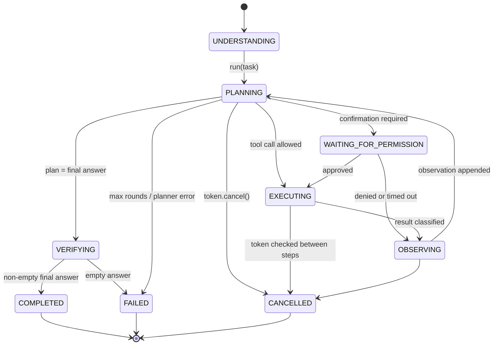
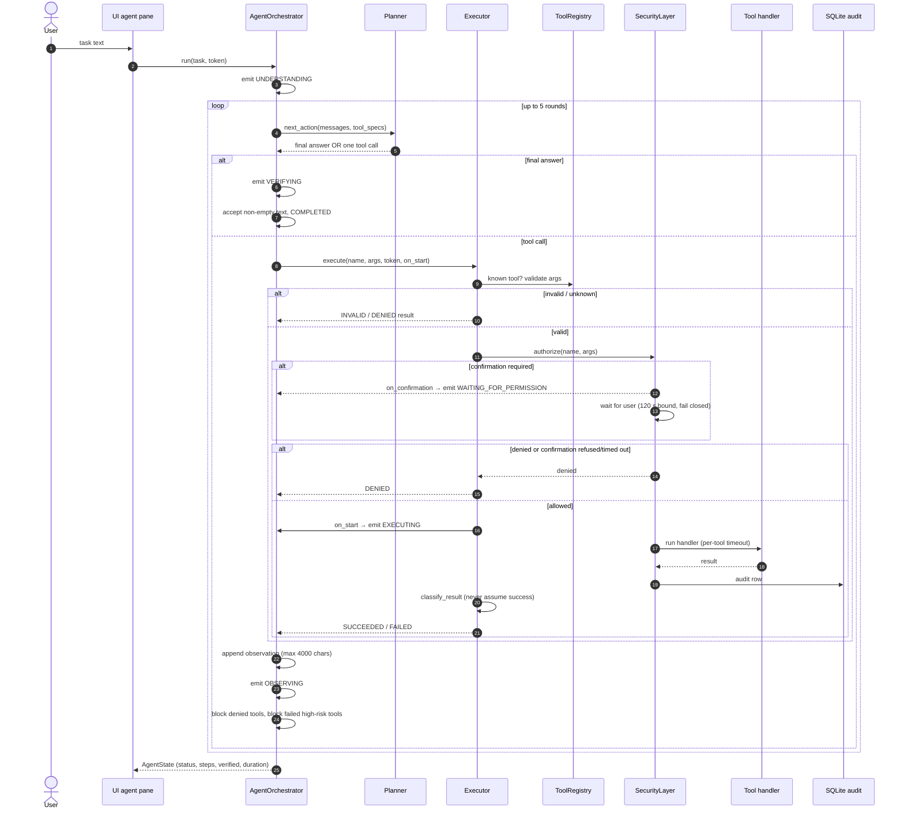
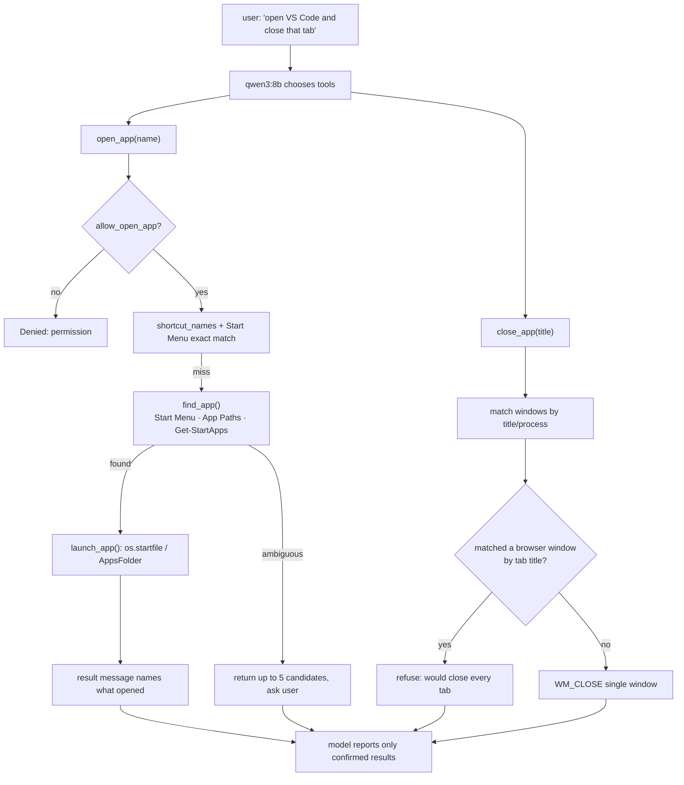
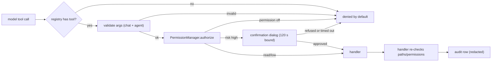

# Himari 4 — Agent Architecture

## What exists today

Himari has **two execution paths**:

1. **Chat tool loop** (`llm.LLM.stream_chat`) — used by normal conversation. The model can call tools
   mid-reply, arguments are validated against the tool schema, observations are appended, and up to
   5 tool rounds run. There is no plan object.
2. **Agent task loop** (`agent/`) — a separate, explicitly started task from the Activity/Agent pane.
   It plans one action at a time, validates arguments, executes with validation and a per-tool
   timeout, tracks explicit lifecycle states, and stops after 5 rounds. It is not used for normal chat.

The target architecture in the upgrade brief (one coherent agent with planning, observation,
verification, and permission states) therefore only partly exists. The agent loop is a good foundation
but is disconnected from ordinary conversation and has gaps listed at the end.

## States (actual)

`AgentStatus` in `agent/state.py` implements exactly these states. `WAITING_FOR_PERMISSION` is set by
a `SecurityLayer.on_confirmation` hook before the blocking dialog; after approval the executor calls
`on_start`, which returns the state to `EXECUTING`. A denied confirmation goes straight to `OBSERVING`.
Every status event includes `verified`.

## C. Agent execution sequence

### Verification semantics

- `classify_result()` treats `None`, empty strings, `{"ok": false}`, and known failure prefixes as
  failures. Anything else is “succeeded”.
- `AgentState.verified` is true only if **every** step succeeded.
- The loop completes with `COMPLETED` whenever the planner returns a non-empty final answer, but the
  status event and final state carry `verified`. The UI labels a completed task with failed/denied/
  invalid steps as “completed (some steps unverified)” and appends a warning, so an unverified outcome
  is never presented as a clean success.
- Per-tool timeouts come from an optional `timeout_seconds` entry on the tool (default 30 s;
  `research_web` and browser tools 90 s, screen-control tools 25 s). A timeout is reported honestly, and the message says
  the action may still be running because a Python thread cannot be killed.

## D. Application control

Two paths exist for controlling applications.

### Chat path (what the user hits by default)

Important properties:

- App discovery is alias-based (`vs code` → “Visual Studio Code”), then substring/registry/Store search,
  and refuses ambiguous names with a candidate list instead of guessing.
- Closing is **not** UI automation: it sends `WM_CLOSE` to a window, never `press_keys` or an
  End-task click. Screen control is a separate, confirmed path that can click a named control or
  send one key/mouse event, but it cannot close or kill a process and there is still no post-action
  screen verification.
- The model is instructed (system prompt) to treat a tool result as the only proof of success.

### Agent path

The agent path uses the same tools and adds argument validation, explicit lifecycle states, risk lookup,
bounded confirmation, verification reporting and a per-tool timeout. Its planning prompt forbids
inventing tools/results and requires honest denial handling.

## Security chain

Risk and permission are defined once in `security/policies.py`, while handlers also re-check paths and
permissions. That double check is intentional defence-in-depth, but it means a new tool must be added
in **both** places and to `tools.TOOLS`.

## Gaps versus the target design

1. **Agent registry drift.** Tools listed in policies but absent from `tools.TOOLS`
   (`installed_apps`, `list_windows`, `find_app`, `capture_screen`, `memory_*`, development and
   integration tools) are denied as “unknown”, so they are dead capability in the agent path.
2. **Cancellation is coarse.** Only between steps; a running handler or a blocking confirmation is not
   interrupted. A confirmation now times out after 120 s, but `Executor` cannot kill a timed-out
   thread and reports that the action may still be running.
3. **Two execution paths.** Chat and agent still execute tools through separate code, with different
   classification and audit structure. Chat results are not classified with `classify_result`.
4. **Planner ignores extra tool calls** (keeps the first, reports how many were ignored) and has no
   retry when the model emits invalid JSON.
5. **Agent and chat share one `busy` flag**, so an agent run and a chat reply cannot proceed at once.
6. **Chat tools have no per-tool timeout**, unlike the agent path.

Verified since the original audit: chat arguments are schema-validated, capability gating is explicit,
`UNDERSTANDING`/`OBSERVING`/`WAITING_FOR_PERMISSION` exist, completion carries `verified`, and both
confirmation paths are bounded.

These remaining items are tracked in stages 2–3 of [UPGRADE_ROADMAP.md](UPGRADE_ROADMAP.md).
