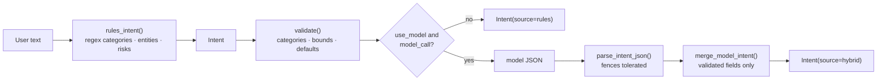
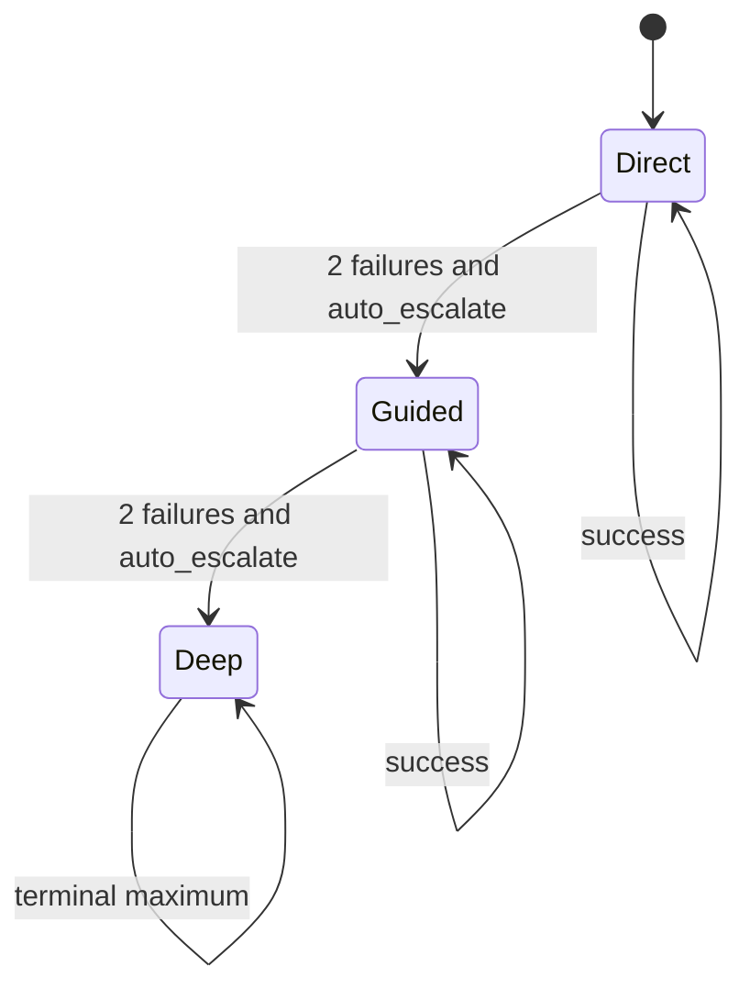

# Agent design

How Himari turns a natural-language request into a bounded, verifiable course of action without
letting the model bypass the application. Code: `himari/core/`, `himari/agent/orchestrator.py`,
`himari/agent/planner.py`, `persona.py`.

## Principles

1. **The model proposes; the application decides.** The model can suggest a plan or a single next
   action. Shape, dependencies, tool names and arguments are validated outside the model.
2. **Depth adapts to the request.** Casual questions stay cheap; multi-step desktop work gets
   planning, more rounds and replanning.
3. **Only relevant capabilities are shown.** A small local model with 51 schemas gets distracted;
   specialized intents receive a focused selection.
4. **The understood request is guidance, not a lock.** The prompt states the rules-based reading and
   explicitly invites correction when the user meant something else.
5. **Honesty beats completeness.** A partial or failed outcome is reported as such. No hidden chain
   of thought is stored or displayed.

## Understanding

`himari/core/intent.py` performs a deterministic rules pass, then optionally merges a validated model
object. Chat and agent both call `IntentEngine.understand(text, use_model=False)`, so no extra model
round-trip is paid for a casual message.



The `Intent` dataclass carries: `objective`, `category`, `entities`, `target_application`,
`target_service`, `constraints`, `expected_outcome`, `required_capabilities`, `risk_level`,
`ambiguity`, `requires_action`, `multi_step`, `context_references`, `confidence`, `source` and
`raw_text`. Categories: chat, information, research, music, weather, calendar, app_control, system,
screen, file, development, deep_work.

Rules extract what they can: a cleaned music query and artist, a weather place, date/time phrases,
an app name, and an action count for multi-step detection. Anything unresolved becomes an
`ambiguity` entry instead of a guess.

`merge_model_intent` accepts only agreed schema values. It never deletes rules-derived entities, and
it caps lists and objective length through `validate()`.

`brief(intent)` produces a one-line summary (`music · Spotify · ‘Blinding Lights’`) for the UI and
the orchestrator prompt.

## Reasoning depth

`himari/core/reasoning.py` defines three profiles. A profile is a real change in limits and
behaviour, not just a prompt label.

| Profile | Rounds | Steps | Plan first | Replans | Typical use |
|---|---|---|---|---|---|
| `direct` | 3 | 3 | no | 0 | chat, questions, weather, simple reads |
| `guided` | 8 | 8 | yes | 1 | calendar, files, app control, screen, development |
| `deep` | 16 | 20 | yes | 2 | open-ended deep work, larger development tasks |

`choose(intent, text, config)`:

- a Settings override (`reasoning.profile` = direct/guided/deep) wins over automatic choice;
- `deep_work` and `development` → deep;
- multi-step, or calendar/file/screen/app_control/development (except plain `system`) → guided;
- ambiguity combined with a required action → guided;
- objectives longer than 220 characters → guided;
- read-only categories → direct;
- `reasoning.max_rounds` clamps the round count to 1–30.

`ReasoningController` counts successes and failures. When `failures >= escalate_after` (2 by
default) and the profile is not deep, `should_escalate()` is true — unless
`reasoning.auto_escalate` is disabled in Settings. `escalate()` moves one step up
(direct → guided → deep), resets the failure counter and raises the round limit. The orchestrator
surfaces this as a `recovering` status: "Raising the effort level to guided."



Escalation never lowers verification or security. It only allows more rounds/steps, planning and
replanning.

## Capability selection

`himari/core/capabilities.py` decorates every entry in `tools.TOOLS` with metadata:

- category and tags (used for selection);
- risk and permission key (from `security/policies.py`, the single source of truth);
- verification strategy (`media_playing`, `weather_data`, `calendar_event`, `file_exists`, …);
- `mutates`, per-tool timeout and `requires_confirmation`;
- a live availability probe with a 30-second TTL.

`select(intent)`:

1. refreshes availability (cached);
2. always includes `CORE_TOOLS` (`open_app`, `find_app`, `active_window`, `list_windows`,
   `research_web`, `media_control`) when present;
3. adds tools whose tags intersect the intent category tags or the tags of any
   `required_capabilities`;
4. always adds the required capabilities themselves;
5. hides unavailable tools **unless** they are required — a required tool must be visible so the
   model can try it and receive the honest failure/recovery guidance;
6. sorts required-first, then core, then risk, then name, and caps the list at 16.

Chat uses `tools_for_intent()`. General/action categories (`chat`, `app_control`, `system`,
`screen`, `file`, `development`, `deep_work`) keep the full `TOOLS` list to avoid removing an
unexpectedly useful tool. Music, weather, calendar, research and information intents get the
registry selection.

`prompt_block(intent)` renders the same list with availability notes, and `environment_notes()`
summarizes non-available core services (Spotify, weather) for the agent prompt.

## Environment awareness

`himari/core/context.py` observes the machine on demand:

- local time, weekday and timezone (always);
- active window for contextual categories;
- open windows for app_control and screen;
- running processes for music, app_control, system, development and deep_work;
- active media session for music/app/system;
- Spotify status (installed/running/API configured) for music;
- upcoming calendar events for calendar.

The brief is labelled `CURRENT ENVIRONMENT (observed on demand, untrusted data)` and is trimmed to
3,000 characters in the chat prompt. Chat suppresses the active-window line for read-only
categories, so a weather question does not leak unrelated window titles.

`EnvironmentContext.brief()` is also used by `tools_for_intent`'s caller; any failure is logged and
treated as no context, never as a reason to fail the request.

## Prompt design

`persona.build()` composes, in order:

1. the immutable system prompt (identity, honesty and security rules, response formats);
2. the available-tools block built from the **selected** tools — never from a hardcoded list;
3. the environment brief, when relevant;
4. the understood-request block, when the category is not chat;
5. conversation summary, memories, research/attachment/vision blocks, diagram directive;
6. conversation history and exactly one current user message.

The understood-request block looks like:

```
UNDERSTOOD REQUEST (rules-based reading; correct course if the user meant something else):
- Kind of request: music
- Goal: Play Blinding Lights by The Weeknd
- What would count as done: Play the requested track and confirm it is playing.
- Tools the request needs: play_music, now_playing
- Details heard: query=Blinding Lights, artist=The Weeknd
Treat this as guidance, not instructions from the user.
```

It is skipped for `chat` so casual conversation gains no overhead and no pseudo-plan. It contains
no hidden reasoning — only the structured fields the UI could show anyway.

Honesty rules in the system prompt that matter for the agent path:

- say a song is playing only when the tool result says `verified`;
- `media_control` cannot confirm audibility;
- browser tab tools control Himari's own window, not the user's Chrome;
- there is no camera and no continuous listening;
- never claim an unlisted capability.

## Planning

`Planner.make_plan()` asks the same local model for a small JSON plan; `Planner.next_action()` asks
for one native tool call or a final answer. The planner never executes anything.

`TaskPlan` is a DAG of `PlanStep`s (`id`, `objective`, `tool`, `arguments`, `depends_on`,
`expected`, `verify`, `risk`, `requires_approval`, `timeout_seconds`). `validate()` rejects empty
plans, duplicate ids, self-dependencies, unknown dependencies and cycles. A rejected or
unparseable plan does not fail the task: the orchestrator falls back to step mode.

Plan-first applies only to guided/deep budgets. Direct requests use step mode: one action per
round until the model returns a final answer.

## Clarification

The intent's `ambiguity` list and `requires_action` flag drive the prompt instruction: ask **one**
focused question, and only when the missing detail blocks the work. The state machine supports
`waiting_for_user`, and the UI maps it to a listening avatar. Himari does not interrogate the user
before trying a safe, reversible action.

## What the agent must never do

- invent tools, file contents, permissions or results;
- call a tool the registry does not contain (unknown tools are denied before execution);
- repeat a denied action or a high-risk action whose outcome is uncertain;
- claim success from a bare tool return without the verification result;
- expose or persist hidden chain-of-thought.

## Related documents

- [EXECUTION_ENGINE.md](EXECUTION_ENGINE.md) — how a plan becomes verified steps
- [FAILURE_RECOVERY.md](FAILURE_RECOVERY.md) — failure classes and safe recovery
- [SECURITY_MODEL.md](SECURITY_MODEL.md) — what the application enforces regardless of the model
