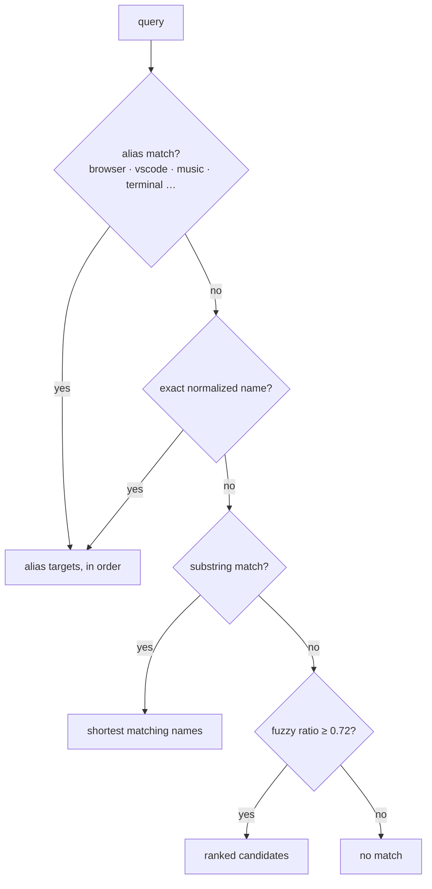
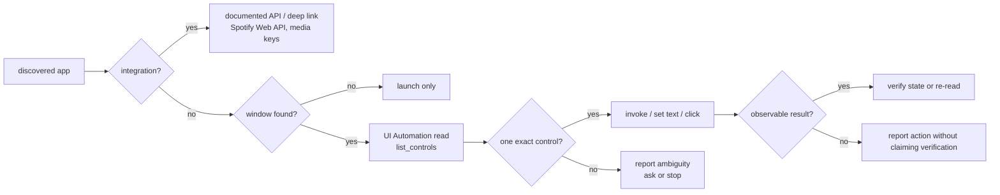

# Application discovery and control

How Himari finds what is installed, decides what it can actually do with an application, and
refuses to guess. Code: `himari/applications/discovery.py`, `himari/windows/apps.py`,
`windows/launch.py`, `windows/uia.py`, `windows/input.py`, `integrations/`.

## The central rule

**Installed does not mean controllable.** Discovery can prove that an application exists and that
it has windows. Control is proven per window and per control:

- an integrated API exists for a few apps (Spotify playback, media keys);
- a window can be read through UI Automation;
- a specific control can be invoked only after it is found unambiguously;
- everything else stays launch/open-only, and the answer says so.

No per-application scripts are hardcoded. Aliases map common words to real applications, but the
target is always resolved against what is actually installed on this machine.

## Sources

`windows/apps.py` merges three read-only sources, deduplicated by name and sorted:

| Source | How | Target stored |
|---|---|---|
| `start_menu` | `.lnk` files under user and all-users Start Menu trees | shortcut path |
| `registry` | `App Paths` keys in HKLM/HKCU, both 32/64-bit views | executable path |
| `store` | `Get-StartApps` via PowerShell (15 s timeout) | AUMID / AppID |

Results are cached for 60 seconds (`CACHE_TTL_SECONDS`); `refresh=True` forces a rescan. Discovery
never launches or modifies anything. On non-Windows or when PowerShell fails, the corresponding
source simply contributes nothing and the failure is logged.

Store apps are launched with `shell:AppsFolder\<AppID>`. Shortcut and registry targets use
`os.startfile`; a missing file is reported as "registered but its files are missing", not as a
successful launch.

## Resolution

`discovery.resolve(query, records, limit=8)` returns ranked candidates and never guesses silently:

Aliases include `browser`, `web browser`, `default browser`, `code editor`, `editor`, `vscode`,
`vs code`, `music`, `music app`, `terminal`, `shell`, `files`, `explorer` and `qoder`. Alias
candidates are marked with the alias that produced them.

`describe(query)` (the `inspect_app` tool):

- no candidates → `{ok: false, error, hint}`;
- several candidates with different targets → `{ok: false, ambiguous: true, candidates: [...]}`;
- one target → `{ok: true, application, target, source, running, windows, support, note}`.

Launching (`open_app`) also refuses ambiguity: `windows.launch_app` raises
`AmbiguousAppError` with the candidate list rather than picking one.

## Support levels

`ApplicationRecord.support` is one of:

| Level | Meaning | Evidence used |
|---|---|---|
| `integrated` | A dedicated integration exists (Spotify, Steam, VS Code, Chrome, Discord) | `integrations/registry.py` |
| `inspectable` | The app currently has a visible window that UI Automation can read | live window list matched by process/title |
| `launchable` | Discovered and launchable, but no readable window right now | installation record |
| `discovered` | Found, but not matched to a launchable target or window | installation record |

Running state is derived from process names and from matching windows. A record that gains a window
is promoted from `launchable` to `inspectable` at describe time.

`inspect_app` includes this note verbatim:

> Integrated means a dedicated integration exists. Inspectable means a window can be read.
> Interactable is verified per control through list_controls, not assumed from installation.

`INTEGRATED_APPS` is a fallback list only; the authoritative set comes from the integration
registry.

## Launch verification

`open_app` does not report success just because `os.startfile` returned:

1. if a matching window already exists, it focuses/reports the existing instance instead of
   opening a second one;
2. otherwise it snapshots window handles and running processes before the launch;
3. it starts the app and waits for a new process or window to appear;
4. it reports what was observed, with a timeout instead of a fabricated "opened".

`close_app` sends `WM_CLOSE` to exactly one matching window. If the match is a browser process and
the user asked for something narrower than the browser itself, it refuses, because closing the
window would close every tab.

## Control ladder

Resolution of windows and controls (`windows/uia.py`):

- a window can be addressed by exact title, substring, process name, or `active`/`foreground` for
  the real foreground window;
- control lookup is exact-first, then substring; more than one match is an error, never a guess;
- password fields are refused; `set_edit_text` is preferred, with a focus + `ctrl+a` + typing
  fallback only for non-password edits when the control pattern is unavailable;
- read-only `list_controls` does not steal focus;
- input is one confirmed action per call, and it reports the real `SendError` count.

## Music as the reference implementation

Spotify shows how discovery, integration and verification combine:

1. `spotify.installed()` checks the Store package and known install paths; `running()` checks the
   process.
2. With configured Web API credentials, `resolve_track()` searches `/v1/search` and ranks results
   against the requested title/artist, rejecting noise words (remix/live/cover/etc.).
3. `play()` opens `spotify:track:<id>`, then polls the Windows media session (`winrt`) for up to
   18 s until the title/artist matches.
4. Only that observation sets `verified: true`. Without credentials, Himari opens
   `spotify:search:<query>` and asks the user to pick the result instead of pretending it played.

The media session is also the verification source for `now_playing` and the partial check for
`media_control`.

## Honest boundaries

- Some integrations stay open-only; their methods return explanations, not fake success.
- Elevated windows that Windows isolates from normal input cannot be automated.
- Browser pages expose only partial accessibility metadata; Himari's own browser uses Playwright,
  while the user's browser is never attached to silently.
- A window title appearing does not prove the app is usable; only a resolved control does.
- Discovery reads metadata; it never indexes file contents or credentials.

## Related documents

- [TOOL_SCHEMAS.md](TOOL_SCHEMAS.md) — discovery tool arguments and results
- [SECURITY_MODEL.md](SECURITY_MODEL.md) — permissions for app control, screen input and browser
- [FAILURE_RECOVERY.md](FAILURE_RECOVERY.md) — what happens when an app is missing or ambiguous
