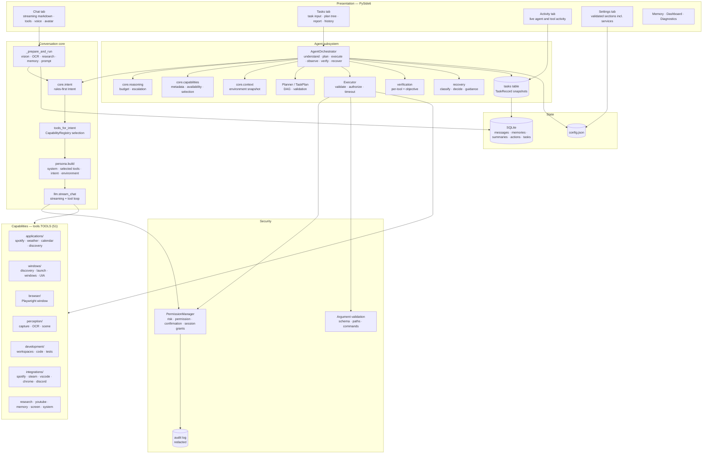
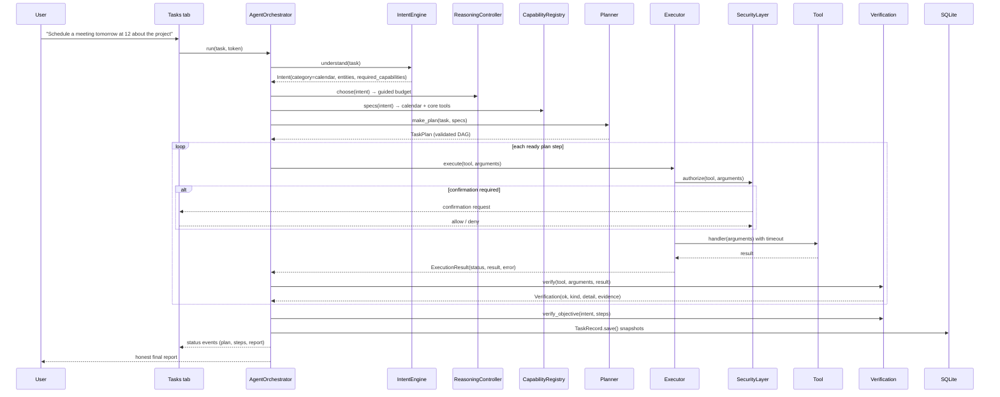

# Himari — Architecture

Status: 2026-11-13. This document describes Himari **as implemented in `himari/`**, not an
aspirational design.

Himari is a local-first Windows desktop companion with two execution paths that share one security
layer, one tool registry and one local model:

- **Chat** — a streaming conversation where the model may call tools one turn at a time.
- **Tasks** — an outcome-driven agent that understands the request, chooses a reasoning depth,
  plans, executes through the security layer, verifies each observed outcome, recovers
  conservatively, and reports honestly.

The agent path extends the companion rather than replacing it: chat, voice, avatar, memory,
sessions, settings and the existing tools keep working.

## Runtime facts

| Concern | Implementation |
|---|---|
| Platform | Windows 10/11 (x64), Python 3.12, PySide6 + QtWebEngine |
| Inference | Local Ollama: `qwen3:8b` chat/tools, `qwen2.5vl:3b` vision |
| Storage | SQLite `%USERPROFILE%\.himari\himari.db`; config `%USERPROFILE%\.himari\config.json` |
| Packaging | PyInstaller one-file `release\Himari.exe` |
| Test baseline | 729 passed, 1 skipped (`python -m pytest -q`) |

## Layers



### What each path receives

| | Chat | Tasks |
|---|---|---|
| Intent | `IntentEngine().understand(text)` — rules only, no extra model round-trip | Same, with recent history |
| Tools in prompt | `tools_for_intent(intent)`; general and action intents keep the full set | `CapabilityRegistry.specs(intent)` |
| Planning | None; the model calls tools turn by turn inside `stream_chat` | Plan-first for guided/deep budgets; otherwise one next action per round |
| Execution | `llm.py` tool loop over security-wrapped handlers | `Executor` → `SecurityLayer.authorize()` → handler with timeout |
| Verification | The result is shown to the model; persona rules forbid claiming unverified success | Per-step `verification.verify()` + `verify_objective()` |
| Recovery | The model adapts from the tool observation | `recovery.decide()` + blocked tools + escalation |
| Reporting | Streamed answer | `AgentState.final_answer`, task report, plan tree, honest status |

## Request lifecycle (Tasks path)



## Runtime shape

- `main.py` → `bootstrap.main()`: proxy sanitising, logging, packaged-asset checks, then `ui.run()`.
- `ui.run()` starts a single `QApplication` and one `MainWindow`. `single_instance.py` holds a
  per-user `QLocalServer` lock; a second launch asks the first window to show and exits.
- All long work runs on `threading.Thread(daemon=True)` and reports back through Qt signals
  (`token`, `status`, `done`, `tool`, `failed`, `cancelled`). There are no `QThread`s.
- Ollama is never spawned or pulled by Himari. A missing model produces an explicit error with the
  `ollama pull` command.
- `config.load()` deep-merges `config.example.json` with the user file, so new keys appear
  automatically. Safe widget values autosave through the validated `control/settings.py` service
  after a 600 ms debounce; `closeEvent()` writes every field, including URLs, model ids and hotkeys.

## Conversation pipeline (Chat path)

Entry point: [ui.py](../himari/ui.py) `send()` → `_begin_generation()` → daemon `_prepare_and_run()`.

1. **Input enrichment** — attachments are parsed (PDF/DOCX/XLSX/text, images), up to 3 images are
   described by the vision model, screen captures fall back to Windows OCR.
2. **Routing heuristics** — `research.should_research()` decides whether to inject web results
   (explicit search, verification, or time-sensitive topics only; local date/time questions are
   excluded); `persona.should_think()` decides whether the model gets a thinking pass (explicit
   planning, debugging, or long multi-step requests only); `persona.directive_for()` adds a
   forced Mermaid instruction for schema requests and a forced `open_video` instruction for
   "play the first video" requests.
3. **Understanding** — `IntentEngine().understand(text)` produces a rules-based `Intent`;
   `EnvironmentContext().brief(intent)` adds only the environment facts relevant to that category
   (time always; media for music; running apps for app/system work; upcoming events for calendar).
4. **Tool filtering** — `tools_for_intent(intent)` asks the capability registry for the relevant
   tools. General intents (`chat`, `app_control`, `system`, `screen`, `file`, `development`,
   `deep_work`) keep the full toolbox; specialized intents (music, weather, calendar, research,
   information) receive the registry selection so a small local model is not distracted by 51
   schemas. Information and research selections include `open_video`, `open_first_result`, and
   `open_url`, so "open the first video/link" can actually run.
5. **Context assembly** — `db.history()` (max 80 messages / 12,000 characters), up to 10
   retrieved memories plus the 5 most recent facts (deduped, max 12), the rolling conversation
   memory, persona instructions, the selected tool block, the environment brief and a short "understood
   request" block are rendered by `persona.build()`.
6. **Generation** — `LLM.stream_chat(..., tools=…)` streams tokens, filters leaked `<think>`
   blocks, accumulates tool calls, executes them through `SecurityLayer`, appends `role:"tool"`
   observations, and repeats up to `MAX_TOOL_ROUNDS = 5`. A reasoning-only reply is retried once
   with thinking disabled. Structured dict results are rendered with `tool_results.as_text()`.
7. **Persistence** — only the final assistant text is stored; intermediate tool calls and
   observations are display-only. After a reply, sessions refresh and, once a chat passes 40
   messages, a rolling conversation memory is rebuilt every 16 messages from everything older
   than the newest 24, so long chats keep names, decisions and open tasks without resending the
   full transcript.

## Agent subsystem

Entry point: Tasks tab `run_agent_task()` → `AgentOrchestrator(..., persist=True).run(task)`.
Details are in [AGENT_DESIGN.md](AGENT_DESIGN.md), [EXECUTION_ENGINE.md](EXECUTION_ENGINE.md) and
[FAILURE_RECOVERY.md](FAILURE_RECOVERY.md).

The orchestrator owns execution. It never lets the model execute anything directly:

```
Intent → reasoning budget → environment snapshot → plan (optional)
       → security-checked tool execution → per-step observation and verification
       → recovery decision → objective verification → report → persisted TaskRecord
```

The Tasks tab shows the plan tree (step, tool, status, verification detail), a completion report,
and a persisted task history that can be reopened after a restart.

## Subsystems

### LLM, tools and prompt assembly
- `LLM` is constructed once with `TOOLS` and the UI `SecurityLayer`. `stream_chat` accepts a
  per-request `tools=` list; without one it sends the full registry. `num_ctx` comes from
  `ollama.context_window` (default 8192).
- Model errors are classified: missing model, transient connection (2 retries), timeout, and
  "does not support thinking" (retried once without `think`).
- `persona.py` holds the system prompt, tool capability block, honesty rules, Mermaid/LaTeX format
  rules, the per-request diagram directive, and the intent/environment blocks.
- Tool specs are OpenAI-style function schemas. `tool_schema.validate_arguments()` is the single
  argument validator for both chat and agent paths; `tool_results.classify_result()` is the single
  success/failure classifier.

### Tools and security
- `tools.TOOLS` is 51 entries of `{name, confirm, spec, fn, silent?}`. Risk, permission and
  confirmation mappings live separately in `security/policies.py`; unknown tools are denied.
- `SecurityLayer.authorize()` checks the permission key, asks for confirmation on risky tools, and
  writes a redacted audit row. `Executor` calls it for every agent step; chat handlers are wrapped
  once with `SecurityLayer.wrap_tools()`.
- The capability registry adds category, tags, risk, permission, verification strategy, timeout,
  mutating flag and a live availability probe to each tool, cached for 30 seconds.
- Details: [SECURITY_MODEL.md](SECURITY_MODEL.md), [TOOL_SCHEMAS.md](TOOL_SCHEMAS.md).

### Applications
- `applications/spotify.py`: Client Credentials Web API search when the user configures a client
  ID/secret, `spotify:track:` deep link playback, Windows media-session verification, optional UIA
  search fallback. Credentials are never hardcoded, logged or placed in prompts.
- `applications/weather.py`: Open-Meteo geocoding and forecast (no API key), WMO code translation,
  IP-based location fallback, 10-minute cache, metric/imperial units.
- `applications/calendar.py`: local SQLite calendar with natural-language date/time parsing,
  approval-gated create/delete, and `.ics` export. Events remain in Himari's own database.
- `applications/discovery.py`: installed-application registry with aliases, fuzzy resolution,
  running/window state and support levels. Details: [APP_DISCOVERY.md](APP_DISCOVERY.md).

### Research and browser
- Research is a regex router around a single DuckDuckGo Lite HTML scrape (5 results, snippets
  only, 8 s timeout, 600 s cache). Results are injected into the system prompt as untrusted data.
- `youtube.py` reads the public results page once and extracts title, channel, duration and watch
  URL from `ytInitialData`. `find_video` is silent and READ, and opens nothing.
- Browser automation uses Playwright **sync** on a dedicated thread behind a queue, launching the
  installed Chrome/Edge/Firefox with a fresh isolated context (no user logins). Registered tools
  cover open, search, open result, tabs, read and close; the interaction layer also contains
  click/fill/submit primitives. Permission: `allow_browser_automation` (off by default). Page
  reading is `inner_text`, capped at 8,000 characters. Opening a result reuses the current tab
  unless `new_tab` is asked for; a search replaces an existing search tab; the tab layer refuses to
  exceed five open tabs. Ordinary open/watch/play requests never reach this layer: the capability
  registry drops `browser_*` tools unless the request explicitly names Himari's browser or its tabs,
  so normal links open in the user's signed-in default browser.

### Windows and integrations
- App discovery merges Start Menu shortcuts, App Paths registry keys, and `Get-StartApps`, cached
  60 s. Launch uses `os.startfile` / `shell:AppsFolder` and verifies a new process or window before
  reporting success; close sends `WM_CLOSE` and refuses to close a whole browser window when only a
  tab title matched.
- `integrations/` defines a registry for Spotify, Steam, VS Code, Chrome, Discord. Methods that are
  not implemented return explanations instead of fake success.

### Perception
- Screen capture uses `mss` (primary monitor by default). `screen.monitor` selects the primary
  screen, all screens, the active window (`active`), or a saved rectangle (`region`). Regions are
  stored in physical pixels and re-validated by the Settings schema before every capture.
- OCR uses the Windows WinRT engine. Vision is a separate local model call; the chat model never
  receives pixels. There is no image generation, drawing or editing path.

### Screen control
- `windows/uia.py` lazily imports `pywinauto`, resolves one visible top-level window by exact
  title, substring, process name, or `active`/`foreground` for the real foreground window, and
  reads its UI Automation descendants. Control lookup is exact-first, then substring; more than one
  match is an error, never a guess.
- `windows/input.py` wraps `SendInput`: Unicode text, key combinations, absolute virtual-desktop
  clicks, and wheel scrolling. It sets per-monitor DPI awareness, bounds one action per call,
  refuses the Windows key, and reports the real `SendError` count.
- Password fields are refused. Policy: `allow_screen_control` (off by default). All input tools are
  HIGH risk and confirmed; `press_keys` is in `NEVER_SESSION_GRANT`.

### Memory
- `memories` table with category/project/normalized columns, dedupe on a normalized string.
- Retrieval is scored keyword matching with a token budget. If `memory.embedding_model` names an
  installed local model, cached vectors add semantic similarity; otherwise retrieval stays
  keyword-only.
- Conversation summaries are generated locally every 24 messages after the first 48 and injected
  into subsequent prompts; overlapping summaries merge and only the latest is read.

### Voice
- STT: faster-whisper (CPU int8). TTS: Piper per sentence to a selectable output device; Russian
  falls back to SAPI. Optional wake-word listening uses an energy VAD and transcribes one complete
  phrase after speech ends.
- Wake word means continuous Whisper transcription of 0.25 s energy-gated chunks; it is CPU-heavy
  and can hear Himari's own TTS.

### Chat rendering and desktop shell
- QtWebEngine with bundled markdown-it, KaTeX and Mermaid, strict CSP (`default-src 'none'`).
  Streaming updates are incremental; settled updates scroll smoothly.
- `ui_effects.py` owns window fade, page fade (skipped for `QWebEngineView` pages), pulse, and
  `CollapsibleSection`. `ui_settings.py` builds Settings and assigns the attribute names `ui.py`
  persists. `ui_widgets.KeyCaptureButton` converts Qt key events into `keyboard` chords.
- `region_select.py` maps a dragged rectangle on a dimmed screenshot to absolute physical pixels.

## Trust boundaries

1. **The model proposes; the application decides.** The planner returns a plan or one tool call.
   The orchestrator validates shape, dependencies and arguments before anything runs.
2. **Every action passes the security layer.** Chat tools are wrapped; agent steps go through the
   executor. Unknown tools are denied by default.
3. **Tool text is untrusted.** Web research, attachments, OCR and the environment snapshot are
   labelled as reference data and are never treated as instructions.
4. **Outcomes are observed, not assumed.** Verification re-reads observable state (media session,
   calendar DB, disk, forecast payload) and labels everything else unverifiable.
5. **Secrets stay out of prompts and logs.** Spotify credentials live in config, are never rendered
   into prompts or normal tool output, and audit arguments are redacted before storage.

## Design constraints that must be preserved

- Local-first: no cloud AI APIs; optional backends must never be mandatory.
- Permission-gated actions; confirmation dialogs must not be bypassed.
- `tools.TOOLS` entries and `LLM.stream_chat(messages, …)` signatures are consumed across UI,
  agent and tests — keep them compatible when refactoring.
- `SecurityLayer.authorize/record_result` and `security/policies.py` are the single source of truth
  for risk; new tools must be registered in both places.
- No hidden chain-of-thought is stored or shown. Tasks persist state, steps, results and reports.
- No hardcoded per-application scripts; capabilities come from discovery, inspection, real APIs or
  documented control surfaces.

## Related documents

- [AGENT_DESIGN.md](AGENT_DESIGN.md) — understanding, reasoning depth, capability selection, planning
- [EXECUTION_ENGINE.md](EXECUTION_ENGINE.md) — execution loop, task state machine, verification, events
- [TOOL_SCHEMAS.md](TOOL_SCHEMAS.md) — result contract, argument validation, tool reference
- [APP_DISCOVERY.md](APP_DISCOVERY.md) — discovery, resolution, support levels, UIA
- [FAILURE_RECOVERY.md](FAILURE_RECOVERY.md) — failure classes, retry safety, escalation
- [SECURITY_MODEL.md](SECURITY_MODEL.md) — permissions, confirmation, validation, secrets
- [UPGRADE_ROADMAP.md](UPGRADE_ROADMAP.md) — completed stages and remaining work
- [MODULE_MAP.md](MODULE_MAP.md), [DATA_FLOW.md](DATA_FLOW.md), [TECHNICAL_DEBT.md](TECHNICAL_DEBT.md)
