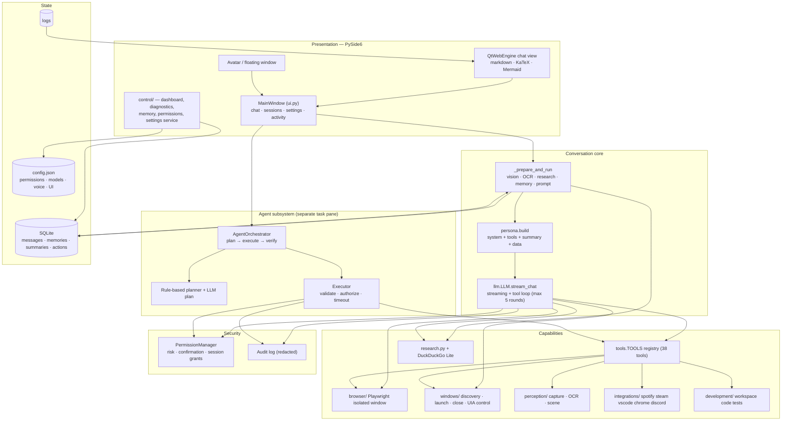

# Himari 4 — Architecture

This document describes Himari **as implemented today**. It was written after a full read of
`himari/` (12,215 lines across 65 modules), not from the README.

- Runtime: Windows 10/11, Python 3.12, PySide6 + QtWebEngine
- Inference: local Ollama (`qwen3:8b` default, `qwen2.5vl:3b` for vision)
- Storage: SQLite at `%USERPROFILE%\.himari\himari.db`, config at `%USERPROFILE%\.himari\config.json`
- Packaging: PyInstaller one-file `release\Himari.exe` (image-engine payload appended as a ZIP)

## Overall architecture

## Runtime shape

- `main.py` → `bootstrap.main()`: proxy sanitising, logging, packaged-asset checks, then `ui.run()`.
- `ui.run()` starts a single `QApplication` and one `MainWindow`. `single_instance.py` holds a
  per-user `QLocalServer` lock; a second launch asks the first window to show and exits.
- All long work runs on `threading.Thread(daemon=True)` and reports back through Qt signals
  (`token`, `status`, `done`, `tool`, `failed`, `cancelled`). There are no `QThread`s.
- Ollama is never spawned or pulled by Himari. `model_status()` only lists installed models; a missing
  model produces an explicit error with the `ollama pull` command.
- `config.load()` deep-merges `config.example.json` with the user file, so new keys appear automatically.
  Safe widget values autosave through the validated `control/settings.py` service after a 600 ms
  debounce; `closeEvent()` writes every field, including URLs, model ids and hotkeys.

## Conversation pipeline (normal chat)

Entry point: [ui.py](../himari/ui.py) `send()` → `_begin_generation()` → daemon `_prepare_and_run()`.

1. **Input enrichment** — attachments are parsed (PDF/DOCX/XLSX/text, images), up to 3 images are
   described by the vision model, screen captures fall back to Windows OCR.
2. **Routing heuristics** — `research.should_research()` regex-decides whether to inject web results;
   `persona.should_think()` decides whether the model gets a thinking pass.
3. **Context assembly** — `db.history()` (max 60 messages / 9,000 chars), up to 8 retrieved memories,
   the latest conversation summary, persona instructions, and any research/visibility blocks are
   rendered by `persona.build()` into one system message + history + current request.
4. **Generation** — `LLM.stream_chat()` streams tokens, accumulates tool calls, executes them through
   `SecurityLayer`, appends `role:"tool"` observations, and repeats up to `MAX_TOOL_ROUNDS = 5`.
5. **Persistence** — only the final assistant text is stored; intermediate tool calls and observations
   are display-only. After a reply, sessions refresh and (for long chats) a background summary may run.

`llm.py` never uses the agent package. The agent is a separate feature launched from the UI task pane.

## Subsystems

### LLM and prompt assembly
- `LLM` is constructed once with `TOOLS` and the UI `SecurityLayer`; tool specs are sent on **every**
  request (no filtering), with `num_ctx` from `ollama.context_window` (default 8192) and `keep_alive`.
- Model errors are classified: missing model, transient connection (2 retries), timeout, and
  "does not support thinking" (retried once without `think`).
- `persona.py` holds the system prompt, tool capability block, honesty rules, Mermaid/LaTeX format
  rules, and the per-request diagram directive.

### Tools and security
- `tools.TOOLS` is a list of `{name, confirm, spec, fn, silent?}` entries. Tool specs are OpenAI-style
  function schemas; there is no output schema, per-tool timeout, or risk field in the registry.
- Risk and permission mappings live separately in `security/policies.py`; unknown tools are denied.
- `SecurityLayer.authorize()` checks the permission key, asks for confirmation on risky tools, and
  writes a redacted audit row. Two safety nets exist: the layer and per-handler permission checks.

### Research and browser
- Research is a regex router around a single DuckDuckGo Lite HTML scrape (5 results, snippets only,
  8 s timeout, 600 s cache). Results are injected into the system prompt as untrusted data.
- `youtube.py` fetches the public YouTube results page once and extracts title, channel, duration,
  and watch URL from the embedded `ytInitialData` JSON (regex fallback for renderer blocks). The
  `find_video` tool wraps it, is silent and READ, and opens nothing.
- Browser automation uses Playwright **sync** on a dedicated thread behind a queue, launching the
  installed Chrome/Edge/Firefox with a fresh isolated context (no user logins). Tools cover open,
  search, open result, tabs, read, click, fill, submit, close. Permission: `allow_browser_automation`
  (off by default). Page reading is `inner_text`, capped at 8,000 characters. Opening a result
  reuses the current tab unless `new_tab` is asked for; a search replaces an existing search tab;
  `tabs.py` refuses to exceed five open tabs.

### Windows and integrations
- App discovery merges Start Menu shortcuts, App Paths registry keys, and `Get-StartApps`, cached 60 s.
- Launch uses `os.startfile` / `shell:AppsFolder`; close sends `WM_CLOSE` to matching windows and
  refuses to close a whole browser window when only a tab title matched.
- `integrations/` defines a registry for Spotify, Steam, VS Code, Chrome, Discord. Several methods are
  intentionally unimplemented and return explanations (e.g. Spotify playback, Discord sending).

### Perception
- Screen capture uses `mss` (primary monitor by default). `screen.monitor` selects the primary
  screen, all screens, the active window (`active`), or a saved rectangle (`region`). Regions are
  stored in physical pixels and re-validated by the Settings schema before every capture.
- OCR uses the Windows WinRT engine.
- Vision is a separate local model call (`qwen2.5vl:3b`); the chat model never receives pixels.
- There is no image generation, drawing, or editing path.

### Screen control
- `windows/uia.py` lazily imports `pywinauto`, resolves one visible top-level window by exact title,
  substring, process name, or `active`/`foreground` for the real foreground window, and reads its UI
  Automation descendants. Control lookup is exact-first, then substring; more than one match is an
  error, never a guess. Active targeting lets control work when several windows share a title.
- `windows/input.py` wraps `SendInput`: Unicode text, key combinations, absolute virtual-desktop
  clicks, and wheel scrolling. It sets per-monitor DPI awareness, bounds one action per call, refuses
  the Windows key, and reports the real `SendError` count.
- `windows/uia.py` fills fields through `set_edit_text` and refuses password fields; it falls back to
  focus + `ctrl+a` + typing only for non-password edits when the control pattern is unavailable.
- Policy: `allow_screen_control` (off by default). All input tools are HIGH risk and confirmed;
  `press_keys` is in `NEVER_SESSION_GRANT`. `list_controls` is READ and does not steal focus.

### Memory
- `memories` table with category/project/normalized columns, dedupe on a normalized string.
- Retrieval is scored keyword matching with a token budget. If `memory.embedding_model` names a
  model already installed in local Ollama, cached vectors add local semantic similarity; otherwise
  and on any embedding failure, retrieval stays keyword-only.
- Conversation summaries are generated locally every 24 messages after the first 48 and injected
  into subsequent prompts; overlapping summaries merge, the newest 10 per session are kept, and
  only the latest is read.

### Voice
- STT: faster-whisper (CPU int8). TTS: Piper per sentence to a selectable output device, Russian
  falls back to SAPI. Optional wake-word listening uses an energy VAD and transcribes one complete
  phrase after speech ends.
- Wake word = continuous Whisper transcription of 0.25 s energy-gated chunks; CPU-heavy and
  can hear Himari's own TTS.

### Chat rendering
- QtWebEngine with bundled markdown-it, KaTeX and Mermaid, strict CSP (`default-src 'none'`).
- Updates during streaming are incremental: only new or changed message cards are sent on the
  70 ms timer, and settled updates scroll smoothly while streaming scrolls instantly.

### Desktop shell and motion
- `ui_effects.py` owns reusable Qt motion: window fade on show, page fade on tab change (skipped
  for `QWebEngineView` pages), a pulse helper, and `CollapsibleSection` with an animated height.
- `ui_settings.py` builds the Settings tab and assigns the attribute names `ui.py` persists; the
  main window no longer contains the settings layout.
- `ui_widgets.KeyCaptureButton` converts Qt key events into `keyboard` chords; global hotkeys are
  removed while recording and rebound after the validated save.
- `region_select.py` photographs the primary monitor, dims it in a frameless overlay, and maps the
  dragged rectangle to absolute physical pixels. The UI runs capture on a worker thread and only
  attaches the image after the user confirms.

## Design constraints that must be preserved

- Local-first: no cloud AI APIs; optional backends must never be mandatory.
- Permission-gated actions; confirmation dialogs must not be bypassed.
- `tools.TOOLS` entries and `LLM.stream_chat(messages, …)` signatures are consumed across UI, agent,
  and tests — keep them compatible when refactoring.
- `SecurityLayer.authorize/record_result` and `policies` mappings are the single source of truth for
  risk; new tools must be registered in both places.

## Related documents

- [MODULE_MAP.md](MODULE_MAP.md) — every module and its responsibility
- [DATA_FLOW.md](DATA_FLOW.md) — message lifecycle and multimodal flow diagrams
- [AGENT_ARCHITECTURE.md](AGENT_ARCHITECTURE.md) — agent states, execution and app-control diagrams
- [TECHNICAL_DEBT.md](TECHNICAL_DEBT.md) — concrete weaknesses with evidence
- [UPGRADE_ROADMAP.md](UPGRADE_ROADMAP.md) — staged plan and status
