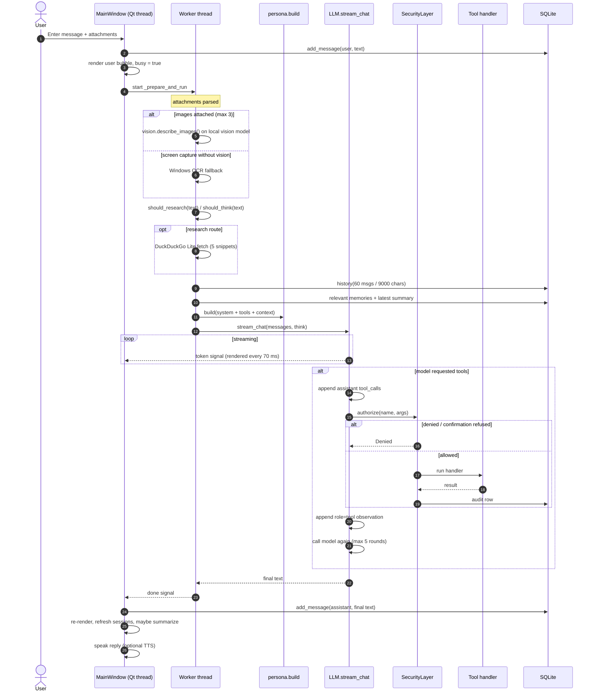
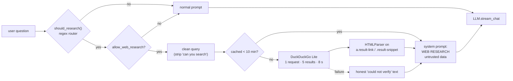
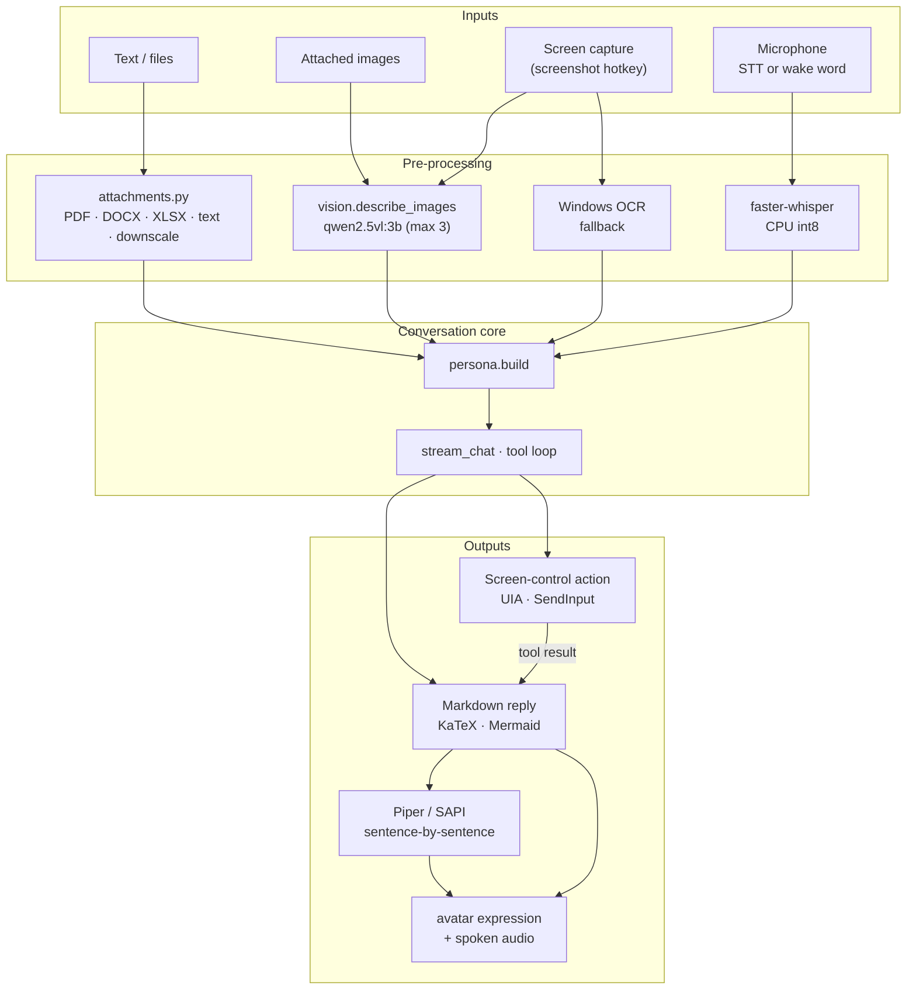

# Himari 4 — Data Flow

## B. Message lifecycle

What happens from pressing **Send** to a rendered reply, with the real call sites.

Key properties:

- Only the **final assistant text** is persisted. Intermediate tool calls and observations live only
  in the local `messages` list of that turn.
- Streaming tokens go straight from the worker to the Qt thread via `token`; the web view is fully
  re-rendered on a 70 ms timer.
- Tool calls are authorized inside the worker thread. A confirmation dialog is marshalled to the UI
  with a blocking `Event.wait()` (no timeout).
- `Cancel` sets one `threading.Event`; it is checked per streamed chunk and before each tool call, so a
  tool that is already running or a model that is still loading cannot be interrupted.
- If the model returns an empty reply, `_short_retry_messages()` drops history/tool rounds and retries
  once with system + last user message.

## Research route

## F. Multimodal flow

Notes:

- The chat model is text-only; images are converted to a description by a separate vision model first.
- OCR and vision are complementary, not equivalent: OCR is used only when vision is unavailable and the
  image came from the screen.
- Screen-control actions are single confirmed steps: UI Automation resolves a named control or
  `windows/input.py` injects one bounded key/mouse event, and the tool result reports what was sent.
  There is no continuous capture, background automation, or image generation.
- Voice input never reaches Ollama during wake-word monitoring; only the final transcript is sent.

## Data stores

| Store | Location | Written by | Read by | Retention |
|---|---|---|---|---|
| `messages` | SQLite | `db.add_message` (user + final assistant) | session list, prompt history | until user clears chat/history |
| `summaries` | SQLite | `memory.summarizer` | prompt assembly (latest only) | accumulates; not pruned |
| `memories` | SQLite | `MemoryManager`, suggestions | retrieval (max 8 per turn) | until deleted |
| `actions` | SQLite | `security.audit` | Activity pane / dashboard | last 50 shown |
| `config.json` | `%USERPROFILE%\.himari` | settings UI at close, config APIs | all subsystems | persistent |
| Logs | `%USERPROFILE%\.himari\logs` | `logging_setup` | diagnostics only | 3 × 2 MB |
| Browser profile | none (fresh context per launch) | Playwright | — | discarded on close |

## Context budget (as sent to Ollama)

| Block | Cap | Source |
|---|---|---|
| System prompt + tool specs | ~10.4k chars (~2.6k tokens) | `persona.build` |
| Conversation summary | 3,000 chars | `db.summary_for_session` |
| Web research | 6,000 chars | `research.research_for_prompt` |
| Vision description | 5,000 chars | `vision.describe_images` |
| Attachment text | 10,000 chars | `attachments.attachment_text_block` |
| Recent history | 9,000 chars | `db.history` |
| Reply | model-controlled | `num_predict` default |

Ollama's `num_ctx` is configured (`ollama.context_window`, default 8192) and sent on every request.
If a prompt still overflows, Ollama keeps only a few tokens when truncating — which is why every block
above is explicitly capped.
