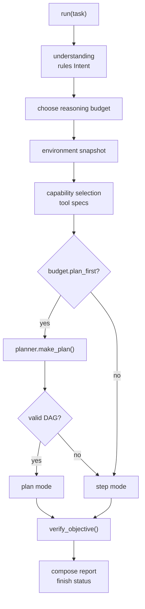
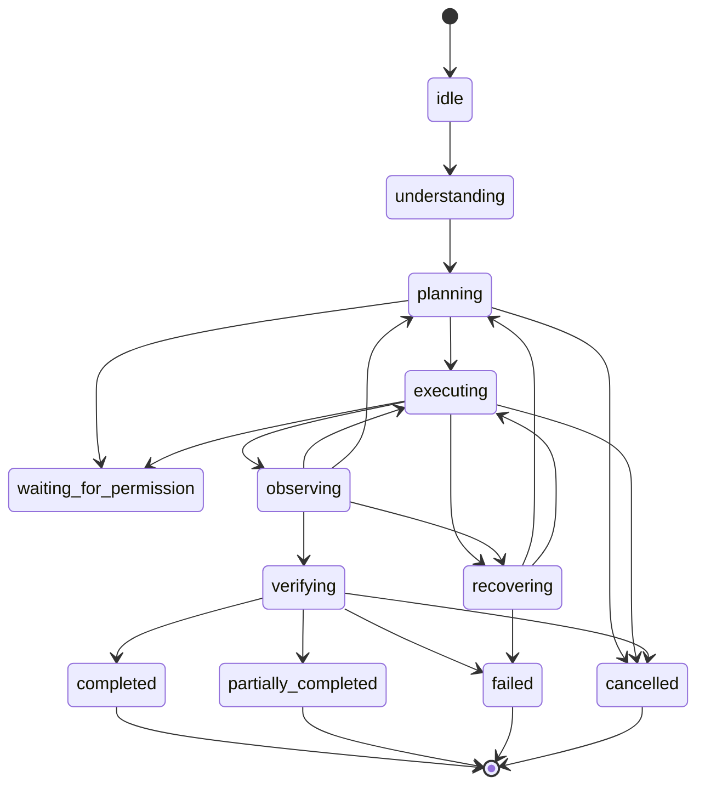
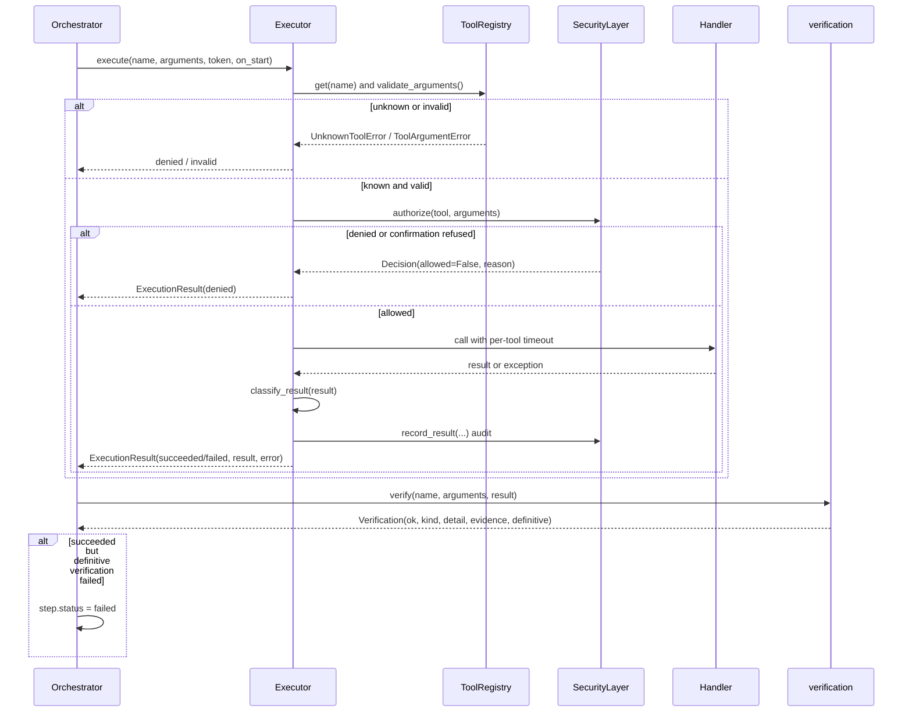

# Execution engine

How a plan becomes observed, verified steps, and how Himari reports what actually happened.
Code: `himari/agent/orchestrator.py`, `executor.py`, `plan.py`, `verification.py`, `task.py`,
`state.py`; UI bridge in `himari/ui.py`.

## Lifecycle

`AgentOrchestrator.run(task, token=None, history=None)` is the single entry point. The UI calls it
through `run_agent_task()` on a daemon thread; tests call `run_task()`.

### Statuses

`AgentStatus` values: `idle`, `understanding`, `planning`, `waiting_for_permission`, `executing`,
`observing`, `verifying`, `recovering`, `waiting_for_user`, `completed`, `partially_completed`,
`failed`, `cancelled`.

`TaskRecord.transition()` enforces the allowed graph and locks terminal states. Illegal transitions
raise, which keeps persisted history honest even if a code path tries to skip verification.

`waiting_for_user` is reachable from planning/understanding; `waiting_for_permission` is emitted
while the security layer blocks on the confirmation dialog. The diagram is abridged;
`TaskRecord.ALLOWED` in `agent/task.py` is authoritative and is enforced at runtime.

## Plan mode

Used when the budget has `plan_first` (guided/deep) and the planner returns a valid `TaskPlan`.

For each round, while the plan is incomplete and `rounds < max_rounds`:

1. `plan.skip_blocked()` marks steps whose dependencies can no longer succeed as `skipped`.
2. `plan.ready()` returns steps whose dependencies succeeded and that have not started. Only the
   first ready step runs this round, so the model sees each observation before the next action.
3. The step's tool and arguments go through `_execute_action()` (below).
4. `_update_plan()` records the result, attempts and verification, mapping `invalid` to `failed` and
   `denied` to `denied`.
5. Success/failure counters feed `ReasoningController`.
6. A tool becomes **blocked** for the rest of the task when:
   - the step was denied (permission disabled or user refusal), or
   - the step failed and either its risk is `high`, or verification was definitive and failed.
7. The observation is appended to the planner messages and persisted.

When the loop ends (complete, out of rounds, or no ready steps), the orchestrator runs
`skip_blocked()` once more, moves to `verifying`, computes `verify_objective()`, composes a report,
and finishes:

- `completed` when the plan succeeded and the objective verified;
- `partially_completed` when at least one step succeeded;
- `failed` when no step succeeded.

## Step mode

Used for direct budgets (and as fallback when planning fails). Each round:

1. `Planner.next_action(messages, specs)` returns either a native tool call or a final answer.
2. A final answer goes through `_finish_with_answer()`: the state moves to `verifying`, the objective
   is checked, and an empty answer is a failure, not a success.
3. Otherwise the action is executed exactly like a plan step and appended to the conversation as an
   assistant tool call plus a `tool` observation.
4. Failures may trigger escalation (`_note_failure_and_maybe_escalate`), which updates the profile
   and raises `max_rounds` when the new budget is larger.
5. Exhausting rounds without a final answer finishes `failed` with an explicit message.

`MAX_AGENT_ROUNDS` is 5; guided/deep budgets can raise `state.max_rounds` to 8/16 unless the caller
passed an explicit `max_rounds`.

## One action, start to finish

Key executor facts:

- Unknown tools are denied by default (`UnknownToolError`), never attempted.
- Arguments are validated against the same JSON schema used by the chat path. Missing required
  values, unexpected keys, wrong types and enum violations produce `invalid` before authorization.
- Timeouts use `tool_exec.timeout_for(entry)`; a timeout is a failure with `timed_out=True`.
- `classify_result()` decides success: a dict with `ok: false` is a failure, an empty string or a
  string starting with "denied:", "tool error:", "could not", "unable to", "cannot " etc. is a
  failure. Structured results are kept intact for verification.
- Exceptions are captured as `failed` with the message; they never crash the task thread.
- Every decision and result is audited with redacted arguments.

## Verification

A tool returning without raising proves only that the call ran. `verification.verify(tool,
arguments, result)` re-observes where the application can:

| Tool(s) | Check | Definitive? |
|---|---|---|
| `play_music` | result says `verified`, or Windows media session reports a track; title in detail | yes |
| `now_playing` | track title present | yes |
| `media_control` | media session returns a title; otherwise unverifiable | partial |
| `weather_forecast` | structured forecast list present, place named; a missing forecast is definitive | failure only |
| `calendar_create` | event id re-read from the calendar DB | yes |
| `calendar_delete` | event id confirmed absent from the DB | yes |
| `calendar_list` | `events` list present | no |
| `calendar_export` | `.ics` file exists at the reported path | yes |
| `write_file`, `write_desktop_file` | file exists on disk at the resolved path | yes |
| `spotify_search` | at least one track returned | no |
| `app_registry`, `installed_apps`, `find_app` | listing itself is the observation | unverifiable |
| everything else | `Verification.unverifiable()` | no |

A `definitive` failure flips a succeeded step to `failed` and blocks that tool for the task.
An unverifiable result stays `succeeded` but the report says the outcome was not confirmed; it is
never presented as verified.

`verify_objective(intent, steps)` aggregates:

- no steps and an answer-only category (chat, information, research, deep_work) → `ok`, kind
  `answer_present`;
- no steps and an action category → not ok, "No action was executed";
- any failed/skipped step → not ok;
- any step whose verification dict says not ok → not ok ("actions ran but their outcomes could not
  be confirmed");
- otherwise → ok, "Every executed step completed and its outcome checked out."

`AgentState.verified` is stricter for UI purposes: every executed step must have status
`succeeded`.

## Persistence and history

When `persist=True` (the Tasks tab), the orchestrator keeps a `TaskRecord`:

- transitions are recorded in `history` with timestamps;
- `intent`, `plan`, `steps`, `report`, `error` and `profile` are saved after status changes;
- terminal state update also records the final report.

`db.save_task(task_id, objective, profile, status, payload)` stores the full JSON snapshot;
`db.load_task(task_id)` and `db.recent_tasks(limit=15)` back the Tasks tab's history. Saving is
best-effort: a busy database never fails the task.

No hidden reasoning is stored. Steps contain tool names, arguments, results, errors, verification
and the recovery decision — the same facts the model observed.

## Event contract

`on_status(event)` receives:

| Key | Meaning |
|---|---|
| `task_id` | stable id shared with the persisted record |
| `status` | `AgentStatus` value |
| `round` | tool rounds used |
| `detail` | human-readable status line |
| `verified` | every executed step succeeded |
| `profile` | active reasoning profile |
| `plan` | plan dict or `None` |
| `final_answer` | report/answer text so far |
| `steps` | list of step dicts (tool, arguments, status, risk, result, error, verification, recovery) |

The UI maps statuses to labels and avatar expressions, renders the plan tree with step status and a
check/verification column, appends live activity lines, and shows the final report. Opening a task
from history re-renders the saved plan and report without re-running anything.

## Cancellation and failure

- `CancellationToken.check()` is called before each round and each tool call; cancellation raises
  `AgentCancelledError` and finishes `cancelled`.
- Any unexpected exception is caught in `run()`, logged, and finishes `failed` with the message.
- Pending confirmation dialogs fail closed on shutdown and after a 120 s timeout.

## Related documents

- [FAILURE_RECOVERY.md](FAILURE_RECOVERY.md) — what happens after a failure
- [TOOL_SCHEMAS.md](TOOL_SCHEMAS.md) — result contract and per-tool arguments
- [SECURITY_MODEL.md](SECURITY_MODEL.md) — authorization details
