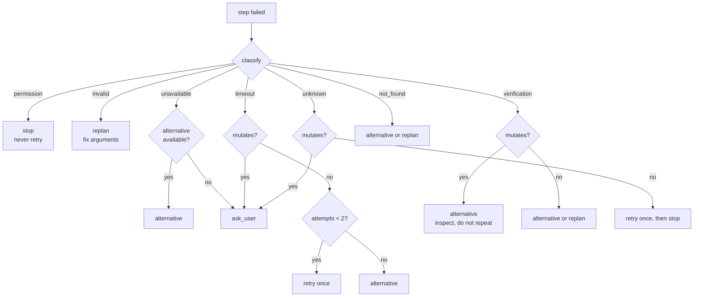

# Failure recovery

Himari's recovery rule is deliberately conservative: **a failed or uncertain mutating action is
never repeated automatically.** The agent is told what went wrong, receives a safe alternative or a
focused question, and the honest outcome is preserved. Code: `himari/agent/recovery.py`,
`orchestrator.py`, `verification.py`.

## Failure classes

`recovery.classify(error, denied=…, invalid=…, timed_out=…, verification_failed=…)` maps an
observed failure to one class:

| Class | Triggered by |
|---|---|
| `verification` | the call completed but the intended outcome was not observed |
| `permission` | denied by Settings, a disabled permission, or the user refused confirmation |
| `invalid` | unknown tool, schema-invalid arguments, bad argument values |
| `timeout` | tool exceeded its per-tool timeout |
| `unavailable` | "not installed", "unavailable", "not available" |
| `not_found` | "not found", "no such", "could not find" |
| `unknown` | anything else |

Classification is based on the error text the executor or verifier produced — it does not inspect
the model's explanation.

## Decisions

`decide(tool, kind, attempts, allowed_tools)` returns a `Recovery`:

| Class | Mutating tool | Read-only tool |
|---|---|---|
| `permission` | `stop` — never retried | `stop` — never retried |
| `invalid` | `replan` (correct the arguments) | `replan` |
| `unavailable` | `alternative` if a working alternative exists, else `ask_user` | same |
| `timeout` | `ask_user` — repeating could duplicate the effect | `retry` once (attempt 1), then `alternative` |
| `verification` | `alternative` — inspect state, do not repeat blindly | `alternative` if one exists, else `replan` |
| `not_found` | `alternative` if one exists, else `replan` | same |
| `unknown` | `ask_user` | `retry` once (attempt 1), then `stop` |

`mutates(tool)` is true when the tool's risk is `medium`/`high` **or** its name contains an action
verb (`write`, `create`, `delete`, `close`, `launch`, `open`, `click`, `type`, `press`, `set_`,
`control`, `play`, `install`, `run_`, `send`, `focus`). This errs toward treating an action as
mutating.

Alternatives are filtered to tools the capability selection actually offered, so the model is
never told to use a tool that is not in this task's toolbox.

`guidance(recovery, tool)` turns the decision into one short observation line:

- the reason;
- `Alternatives: a, b.` when applicable;
- `Ask one focused question or stop and explain.` / `Produce a corrected next step.` /
  `Do not retry this action.`



## What the engine actually enforces

`Recovery` is advisory to the model, but the orchestrator enforces hard stops:

1. **Blocked tools.** A tool is added to the task's blocked set when:
   - its step was denied (permission or user refusal), or
   - it failed and its risk is `high`, or
   - it failed and verification was definitive and negative.
   Any later attempt at that tool is marked `denied` before execution and never reaches the
   handler. The model receives the message: "This action was denied or failed earlier and will not
   be retried automatically. Choose a different approach."
2. **No automatic execution of alternatives.** The model must choose the next action; the
   security layer still authorizes it.
3. **No automatic retry loop.** Read-only retries are guidance (`retry_allowed=True`); the model
   decides, and the blocked set prevents a high-risk repeat.
4. **Escalation is bounded.** Two failures on a non-deep profile can raise reasoning depth
   (direct → guided → deep), increasing rounds/steps and enabling replanning. It cannot exceed the
   deep budget.
5. **Plans adapt structurally.** Dependent steps whose prerequisite failed are marked `skipped`; the
   report counts skipped steps as not done.

## Recovery frames in observations

The model sees the step result plus verification plus guidance, for example:

```
Result: {"ok": false, "verified": false, "method": "spotify-api",
         "error": "Spotify opened 'Blinding Lights' by The Weeknd, but the Windows
         media session did not confirm playback. ...", "retry_safe": false,
         "alternatives": ["now_playing", "media_control"]}
 Not verified: Playback was not confirmed. The call completed but the intended
outcome was not observed. Do not repeat it blindly; inspect the state and use
another method. Alternatives: now_playing, media_control.
```

That is the complete information the model gets. No hidden reasoning is added.

## Tool-level honesty fields

Mutating tools should include, where applicable:

- `retry_safe: false` when the action may already have executed;
- `alternatives: [...]` with real tool names;
- a specific `error` sentence describing what was and was not observed.

`play_music` is the reference: it distinguishes "Spotify is not installed", "Spotify started but no
process appeared", "the track opened but playback was not confirmed", and "search is open, pick a
result". Each produces a different recovery path.

## Case walkthroughs

### Permission denied

1. Settings has `allow_write_file` off.
2. `authorize()` returns denied; the step is `denied` with the exact permission name.
3. `classify` → `permission`; `decide` → `stop`.
4. The tool joins the blocked set for the task.
5. The report says the write did not happen and why. Nothing is retried.

### Verification failed after an action

1. `play_music` returns `ok: true` from the deep link but `verified: false`.
2. `verify` returns a definitive failure; the step becomes `failed`.
3. `classify(verification_failed=True)` → `verification`; `decide` → `alternative`.
4. The tool is blocked; the model is told to check `now_playing` or use `media_control`.
5. The final report says the song was opened but playback was not confirmed.

### Read-only timeout

1. A weather or web lookup exceeds its timeout (read-only, does not mutate).
2. `decide` allows one retry; a second failure moves to an alternative (`research_web`).
3. The user sees the timeout and the substituted method in the activity list.

### Invalid arguments

1. The model emits an unknown argument, wrong type, or missing required value.
2. The executor returns `invalid` before authorization; the handler never runs.
3. `decide` → `replan`; the model is told to correct the call.
4. On a plan, the failed step is not retried with the identical arguments.

### Ambiguous application

1. `open_app`/`inspect_app` finds two plausible matches.
2. The tool returns the candidate names and the ambiguity flag instead of choosing.
3. Recovery suggests `find_app`/`installed_apps`; the model asks one focused question if needed.

## What recovery does not do

- It does not undo completed actions; there is no transaction or rollback.
- It does not silently retry a write, delete, launch, click or playback command.
- It does not claim success to avoid reporting a failure.
- It does not weaken permissions to get past a denial.
- It does not loop forever: rounds, steps and escalation are all bounded.

## Related documents

- [EXECUTION_ENGINE.md](EXECUTION_ENGINE.md) — where verification and blocking happen
- [AGENT_DESIGN.md](AGENT_DESIGN.md) — reasoning escalation
- [TOOL_SCHEMAS.md](TOOL_SCHEMAS.md) — `ok`, `verified`, `retry_safe`, `alternatives`
