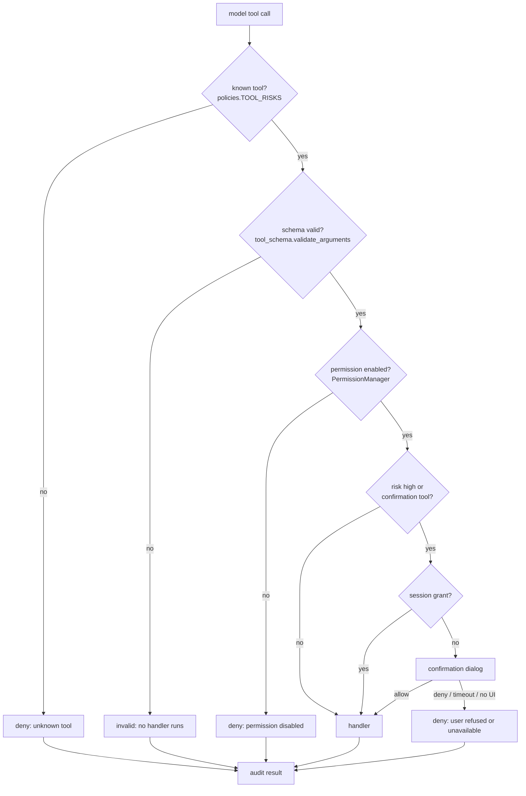

# Security model

Security is enforced by the application, not by the model. A plan, a tool call or a sentence in a
web page can suggest an action; only `SecurityLayer.authorize()` can allow it. Code:
`himari/security/`, `himari/tool_schema.py`, `himari/tool_exec.py`, `himari/agent/executor.py`.

## Fail-closed principles

1. **Unknown tools are denied.** Every tool must appear in `security/policies.py`; anything else is
   treated as high risk and refused before a handler can run.
2. **No callback means no approval.** If a confirmation cannot be shown, the action is denied.
3. **Timeouts are denials.** An unanswered confirmation expires after 120 seconds; shutdown denies
   every pending request.
4. **The model cannot grant itself permission.** Session grants are created only by an explicit
   user approval of a high-risk action.
5. **Validation happens before authorization and execution.** Bad arguments never reach a handler.
6. **Every decision is audited.** Allowed, denied and executed outcomes are written with redacted
   arguments.

## Enforcement layers

Defense in depth:

- The **chat path** wraps every handler with `SecurityLayer.wrap_tools()`, so a direct call from the
  model still authorizes.
- The **agent path** authorizes inside `Executor.execute()`, independently of the chat wrapper.
- **Handlers** keep their own permission checks (for example `open_app` checks `allow_open_app`), so
  a future call path that forgets the layer still fails closed.
- **Path and command validation** is applied inside the tools that touch files or shells.

## Risks and permissions

Risk levels: `read`, `low`, `medium`, `high`. Unknown names map to `high`.

Examples:

| Level | Tools |
|---|---|
| read | `weather_forecast`, `calendar_list`, `now_playing`, `active_window`, `list_controls`, `app_registry`, `read_file`, `scan_large_files`, `watch_status`, `inspect_system`, `diagnose_program`, `inspect_settings`, `setup_guide`, `setup_verify`, `youtube_transcript`, `vscode_editors`, `vscode_read`, `propose_change`, `project_context` |
| low | `open_app`, `play_music`, `media_control`, `set_volume`, `open_url`, `open_video`, `research_web`, `calendar_export`, browser open/search, `watch_stop`, `setup_remember`, `remember_activity` |
| medium | `write_file`, `write_desktop_file`, `calendar_create`, `calendar_delete`, `close_app`, `focus_window`, `capture_screen_text`, `screen_scene`, `watch_start`, `watch_observe`, `apply_change`, `run_tests` |
| high | `run_command`, `click_control`, `set_control_text`, `type_text`, `press_keys`, `click_at`, `scroll_screen`, `open_project` |

Permission keys and defaults (from `config.example.json`; a user's config may differ, and Settings
is the source of truth):

| Permission | Default | Gates |
|---|---|---|
| `allow_open_app` | on | launch, focus, close, play_music |
| `allow_open_url` | on | open/search web pages, open one video |
| `allow_web_research` | on | research, video lookup |
| `allow_vision` | on | image description |
| `allow_volume` | on | volume changes |
| `allow_read_file` | on | read files, list project files, scan folder sizes |
| `allow_screen_capture` | on | screenshots, OCR, scene |
| `allow_screen_control` | **off** | UIA control, typing, clicking, key presses |
| `allow_active_window` | **off** | reading the foreground window |
| `allow_media_control` | **off** | pause/resume/skip |
| `allow_run_command` | **off** | shell commands |
| `allow_write_file` | **off** | file writes, desktop files |
| `allow_browser_automation` | **off** | Playwright tools |
| `allow_watch_mode` | **off** | watch session start, stop, status and each look |
| `allow_system_diagnostics` | **off** | read-only system and program diagnosis |
| `allow_vscode_state` | **off** | reading open editors and VS Code workspace state |
| `allow_run_tests` | **off** | allowlisted project test commands |
| `allowed_folders` | `~/Documents`, `~/Downloads` | file path confinement |

`calendar_create`, `calendar_delete`, `weather_forecast` and `spotify_search` have no separate
permission key; their protection is the confirmation/risk model.

## Confirmation

`CONFIRMATION_TOOLS` includes every medium action that changes user state and every high-risk
screen action: file writes, calendar create/delete, close app, focus window, screen capture,
`run_command` and all input tools. The companion skills add `watch_start`/`watch_observe` (each
look is confirmed unless the user granted it for the session), `apply_change`, `run_tests`,
`propose_change` and `vscode_read`, so reading or changing code is always explicit.

- High-risk approvals can be remembered for the session (`PermissionManager.grant_session_permission`)
  — except `press_keys` and `browser_submit`, which are in `NEVER_SESSION_GRANT`.
- Medium actions such as `write_file` and `calendar_create` ask again every time.
- The dialog is shown from the UI thread via the `confirm_callback`; the executor blocks on a
  `threading.Event`.
- Denial, timeout, a closed window or a shutdown all resolve to **no**, and the step is recorded as
  `denied` with the reason.

## Path and command validation

`security/validation.py`:

- expands variables and `~`, resolves the path without requiring it to exist;
- refuses Windows system directories (`\windows\system32`);
- refuses credential filenames (`.env*`, `id_rsa`, `id_ed25519`, `credentials.json`,
  `secrets.json`, `ntds.dit`);
- refuses private-key/certificate suffixes (`.pem`, `.key`, `.pfx`, `.p12`, `.keystore`, `.ppk`);
- confines accepted paths to the configured `allowed_folders`;
- validates commands through the development test runner's allow-list before `run_command`;
- rejects NULs and over-long text fields.

Input tools set per-monitor DPI awareness, bound one action per call, refuse the Windows key and
never fill password fields.

## Untrusted content and prompt injection

- Web research, page text, attachments, OCR output, vision descriptions and the environment
  snapshot are explicitly labelled as untrusted reference data.
- Tool results are data; the system prompt says the model must not follow instructions found inside
  them.
- Even if the model is persuaded, it cannot bypass authorization: unknown tools, disabled
  permissions and unconfirmed high-risk actions are refused outside the prompt.
- The agent's planner prompt forbids inventing tools, results, file contents or permissions.

## Secrets

- Spotify Client ID/Secret are user-provided Settings values, stored in the local
  `config.json` (same as the rest of the configuration, not a separate keychain). They are never
  hardcoded, never placed in prompts, and never returned by tools.
- The Client Credentials access token is cached under the Himari data directory with its expiry.
  No refresh token exists for this flow.
- Audit arguments redact sensitive keys (`password`, `token`, `secret`, `api_key`, `authorization`,
  `cookie`, `session`, `credential`) and obvious secret value patterns (`Bearer …`, `sk-…`,
  `ghp_…`, `xox…`).
- Tool results are stored as returned; handlers must not put credentials into them.
- No telemetry, analytics or cloud sync. The only external calls are the explicit Spotify Web API,
  Open-Meteo, DuckDuckGo Lite/YouTube page reads and the user's own configured Ollama.

## Agent-specific rules

- The agent uses the same permissions and confirmations as chat; there is no "agent mode" bypass.
- A denied or definitively failed high-risk tool is blocked for the rest of the task; the model is
  told it will not be retried.
- Recovery cannot lower a permission or widen `allowed_folders`.
- Reasoning escalation changes effort, not authority.
- Confirmation requests update the task status to `waiting_for_permission` so the UI explains why
  the task paused.
- Task records store state, arguments, results, errors and reports — never hidden chain-of-thought.

## Auditing

`db.log_action(tool, entry, result, allowed)` records:

- tool name, risk, allow/deny decision and reason;
- redacted arguments;
- the handler result when one exists;
- an outcome object (`ok`, `error`) when the security layer recorded the call.

Audit rows are local SQLite. The Activity tab reads the actions table; Diagnostics reports system
and model state.

## Known limits

- Work inside elevated windows cannot be automated from a normal-integrity process.
- A screenshot or OCR result can contain sensitive content; capture is permission-gated and never
  saved automatically.
- Once a high-risk tool is granted for the session, later calls of that tool do not re-prompt
  (except `press_keys`/`browser_submit`). Restarting Himari clears session grants.
- Config files are protected by the Windows user profile, not by application-level encryption.

## Related documents

- [FAILURE_RECOVERY.md](FAILURE_RECOVERY.md) — denial and failure handling
- [TOOL_SCHEMAS.md](TOOL_SCHEMAS.md) — per-tool risk, permission and confirmation
- [APP_DISCOVERY.md](APP_DISCOVERY.md) — screen and app control boundaries
